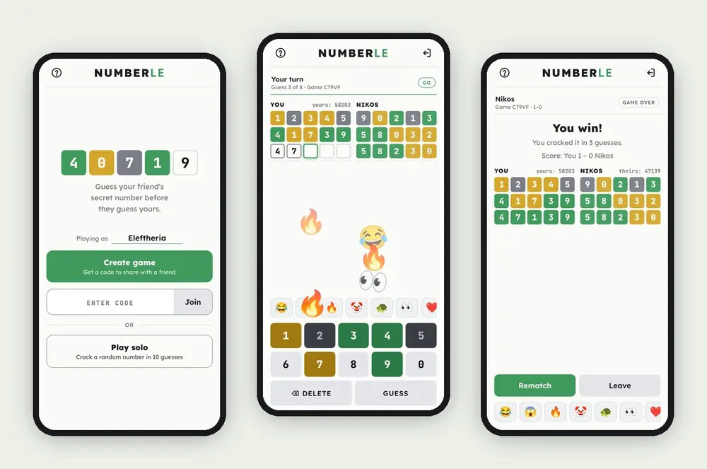
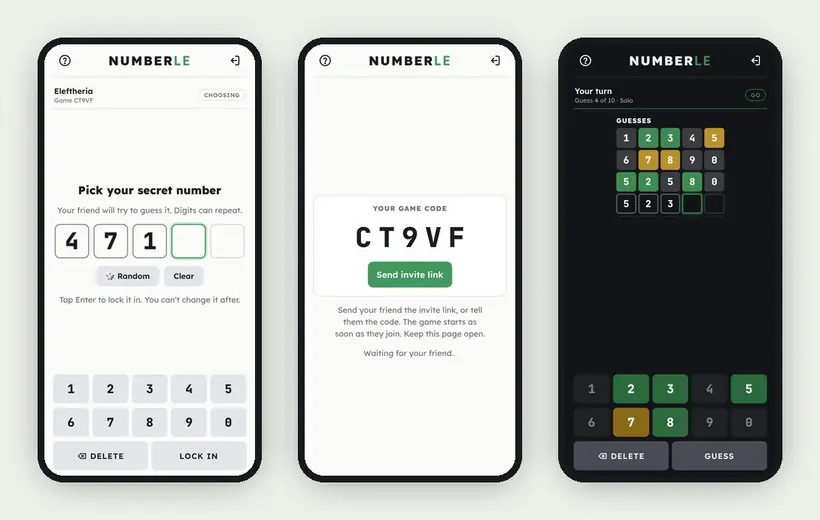

# 🔢 Numberle

**Wordle for numbers. Crack your friend's secret number before they crack yours.**

## What is it?

Numberle is a guessing game for your phone. Instead of a five-letter word, you're hunting a **five-digit number**. Every guess lights up the digits so you know how close you are:

| Tile | Meaning |
| :--: | --- |
| 🟩 | Right digit, right spot |
| 🟨 | The digit is in the number, but somewhere else |
| ⬜ | Not in the number (or not that many times) |

Digits can repeat, and the number can start with 0, so `00728` and `55555` are fair game.

## Two ways to play

### 👥 Challenge a friend

1. Tap **Create game** and send your friend the invite link (or just tell them the 5-letter code).
2. You both pick a **secret number**. Can't decide? Hit 🎲 **Random**.
3. Take turns guessing each other's number. A coin flip decides who goes first, and you each get up to **8 guesses**.
4. First to crack it wins. If you crack it first, your friend still gets their turn in that round to tie it up.
5. Tap **Rematch** to go again. The score between you two is kept at the top.

While you wait for your friend, **spam them with emoji**. Swipe the emoji strip, tap one to send it, or hold it down to send a stream. 🔥🔥🔥

### 🧠 Play solo

Tap **Play solo** and crack a random number in **10 guesses**. Your best score is saved on your phone.

## Features

- **No sign-up, no download.** Open the link and play in any phone or desktop browser.
- **Invite links** fill in the game code for your friend automatically.
- **Pick up where you left off.** If someone loses signal or closes the page, the game pauses and a **Resume** button brings you back.
- **Light and dark mode** follow your phone's setting.
- **Colorblind mode** swaps to blue and orange and adds ✓ and ↔ symbols to the tiles.
- **Vibration and sound** effects you can switch on or off under the **?** menu.

## How the online game works

The two phones never connect to each other directly. Instead, they meet on a shared "notice board" in the cloud:

1. **The game code is a spot on the board.** Each game gets two slots, one for each player.
2. **Each phone posts to its own slot.** Every time something changes (your name, your guesses, the colors you gave your friend's guesses), your phone posts its latest state. It also re-posts every few seconds, so the other phone knows you're still there.
3. **Each phone watches the other slot.** As soon as your friend posts, your phone gets it, usually within a second or two.

This uses [MQTT](https://mqtt.org/), a lightweight messaging system, through two free public servers (HiveMQ and EMQX) at the same time. If one is down, the game carries on through the other. Because each phone just connects to a server, the same way it opens a web page, it works on any Wi-Fi or mobile network.

Your secret number **never leaves your phone**. When your friend guesses, only their guess is sent to you. Your phone works out the colors, and only the colors go back. Both numbers are revealed when the game ends.

> **Good to know:** the servers are public, so names, guesses and colors pass through them as they are. Someone who knew your game code could in theory read along, but your secret number is never sent.

> **Stuck on "Waiting"?** Make sure you're both on the latest version: close the page and open the link again.

## Run it yourself

The whole game is a single file: [`index.html`](index.html). Open it in a browser, or fork this repository and turn on **Settings → Pages** to host your own copy.

---

Made with 🧡 by [@eleuthpap](https://github.com/eleuthpap)

**[Play Numberle →](https://eleuthpap.github.io/numberle/)**

